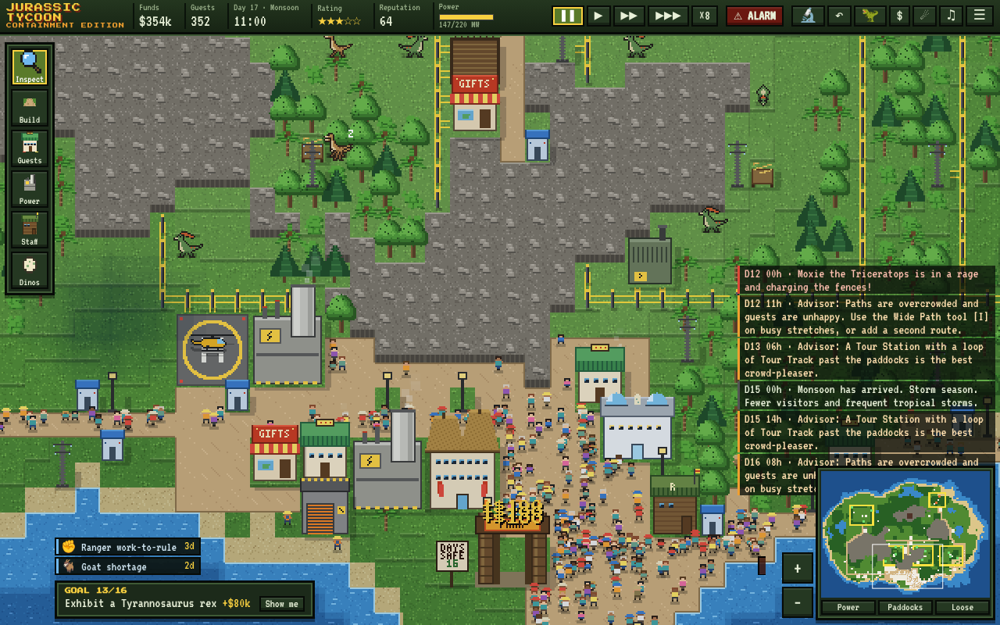
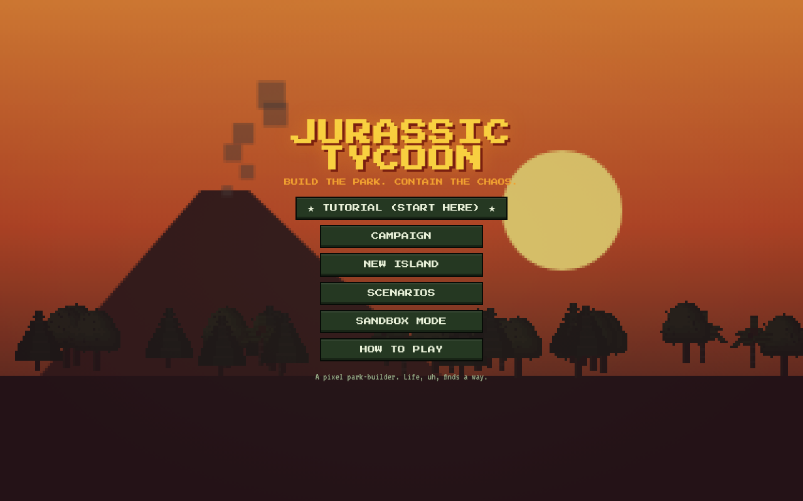

# Jurassic Tycoon: Containment Edition

A pixel-art dinosaur park builder that runs in the browser. Fence paddocks, power the fences, hatch
dinosaurs, bring in the guests, and then deal with storms, sabotage, eruptions and very clever raptors.

**[Play it now](https://mszarski.github.io/jurassic-park-tycoon/)** in any modern browser, on desktop or
phone. It installs as an offline app. Or clone the repo and open `index.html`: there is no build step.



## What is in it

- **12 species**, from Gallimimus to T. rex, Pteranodons in an Aviary and an Indominus that hides and schemes.
  Each needs space, cover, water, a herd and food; unhappy animals test the fences.
- **A power grid** that the electric fences depend on. A blackout lets the carnivores out.
- **Guests** with names and hometowns who eat, shop, stay in the hotel, ride jeeps and gyrospheres, and run
  for the shelters when the alarm sounds.
- **Breaches you can fight**: rangers with tranquilizer rifles, helicopter airlifts, engineers, sirens,
  bunkers. Everyone works on their own, or you can give orders RTS-style.
- **Eight disasters**, on their own schedule or at your command.
- **A five-chapter campaign** and **six scenarios**, each with medals.
- **Four difficulties**, from Calm (no disasters) to Chaos Theory (predators run for the crowd).
- **Research**, seasons, InGen phone calls with deals that bite later, paddock templates, undo, save/load,
  island codes, sandbox mode, and an original chiptune soundtrack.
- **A late game**: the Amber Museum, Ferry Terminals and endless Legacy levels.

## Documentation

- **[Playing](docs/playing.md)**: how the park works, every species and building with its numbers, what to do
  in a breach, controls.
- **[Scenarios and campaign](docs/scenarios.md)**: objectives, medals and perks.
- **[Development](docs/development.md)**: code layout, tests, the balance sweep, build and deploy.

## Quick controls

| Input | Action |
| --- | --- |
| Click / drag | Use the tool: drag for paths, fences and paddocks |
| Right-drag, WASD, arrows | Pan |
| Wheel / pinch | Zoom |
| Space, 1–4 | Pause / speed |
| E | Evacuation alarm |
| B | Respond to a breach |
| U or Ctrl+Z | Undo |

The full table is in [Playing](docs/playing.md#controls).

## Development

Plain JavaScript in `src/`, loaded by `index.html`. Tests are headless Playwright scripts:

```bash
npm install --no-save --no-package-lock playwright@1.56.1 && npx playwright install --with-deps chromium
node tools/ci.js                # the test suite
node tools/balance.js --full    # bots play every scenario and chapter, well and badly
```

Every push runs both; `main` deploys to GitHub Pages when they pass. See [Development](docs/development.md).


